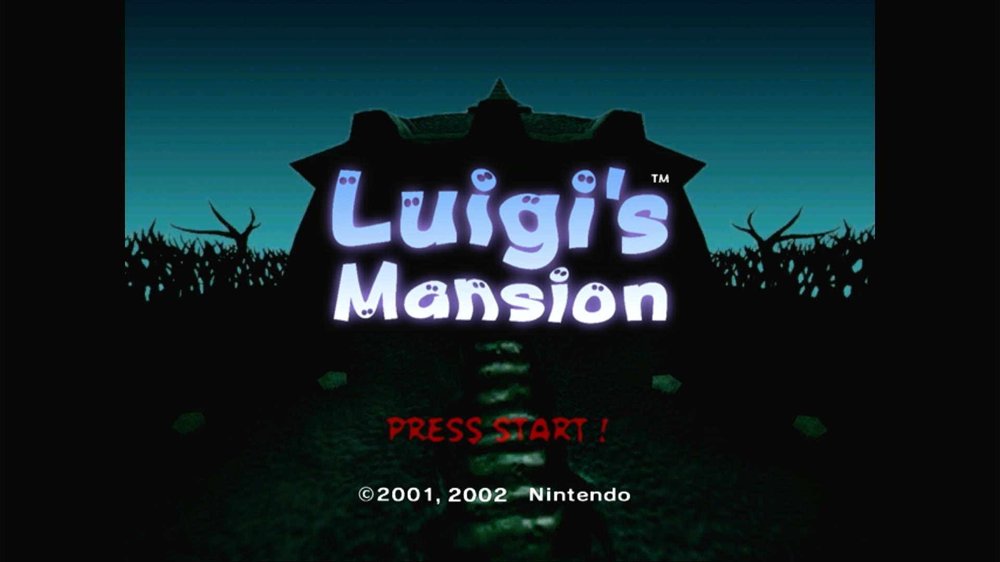
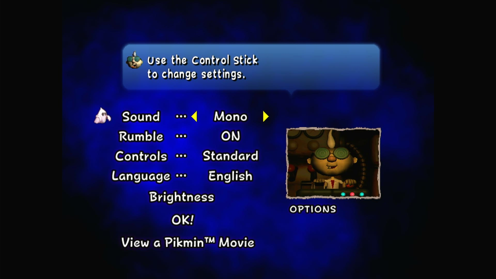

# LuigisMansion-X360

**English** | [Português (Brasil)](#português-brasil)

A native Xbox 360 port of **Luigi's Mansion** (Nintendo GameCube). The game is recompiled from **your own disc**
into a native `.xex` that runs directly on the console, with no GameCube emulation.

**Status:** the whole game is playable on a real Xbox 360, with graphics, audio, saves and controller.
Work on smoothness and small details continues.

**No game data is included, and none will be.** You need your own copy of the game: the European release,
revision 0 (*Luigi's Mansion (Europe) (En,Fr,De,Es,It)*). Never share the files the build produces: they contain
code translated from the game.

## Screenshots (real Xbox 360 hardware)

| | |
|---|---|
|  |  |
|  |  |
|  |  |

## Building it yourself

**You need:**
- Windows with Visual Studio 2010 and the Xbox 360 SDK installed (the `XEDK` environment variable set).
- Python 3 with `numpy` and `zstandard` (`python -m pip install --user numpy zstandard`).
- Git Bash (or another `bash`) to run the build script.
- Your own disc image of the European release, revision 0 (`.rvz` or `.iso`).
- The symbol files of the Luigi's Mansion decompilation (public domain), which come with
  [luigis-mansion-recompiled](https://github.com/rob646464/luigis-mansion-recompiled):
  `git clone https://github.com/rob646464/luigis-mansion-recompiled Reference/LuigisMansionPC`

**Steps** (from the repository folder):
1. Extract your disc:
   `python Tools/rvz_extract.py extract "<your image>.rvz" GameData/GLMP01_rev0`
2. Build everything:
   `bash Xbox360/rebuild_all.sh`
3. The result is `Builds/xex/default.xex`.

**On the console**, put these together in one folder:
```
default.xex
sys\     (from GameData/GLMP01_rev0/sys)
files\   (from GameData/GLMP01_rev0/files)
```
Start `default.xex` from your dashboard (Aurora, FSD...). Saves are created in a `saves` folder next to it.

## Found a bug or a glitch? Please tell me

If something goes wrong (graphics, sound, a crash, a freeze, slowdown, a control that does not respond...),
please open an [issue](../../issues/new/choose) so I can try to fix it. It helps a lot to include:
- the files **`lm360.log`** and **`lm360_gx.log`** that the game writes next to `default.xex`;
- what you were doing and where in the game, and if you can, a short **video** or photo;
- your console and how you started the game.

## Credits

- The graphics and audio core comes from the Super Mario Sunshine Xbox 360 port (MIT license, see
  `Source/thirdparty/sms_gx/LICENSE.txt` and `Source/thirdparty/sms_audio/LICENSE.txt`).
- Symbol names come from the Luigi's Mansion decompilation project's configuration (public domain).

Luigi's Mansion is a trademark of Nintendo. This project is not affiliated with or endorsed by Nintendo.

---

## Português (Brasil)

Port nativo de **Luigi's Mansion** (Nintendo GameCube) para Xbox 360. O jogo é recompilado a partir do **seu
próprio disco** para um `.xex` nativo, que roda direto no console, sem emulação de GameCube.

**Estado:** o jogo inteiro já pode ser jogado num Xbox 360 de verdade, com imagem, áudio, saves e controle. O
trabalho continua na fluidez e em pequenos detalhes.

**Nenhum dado do jogo é ou será incluído.** É preciso ter a sua própria cópia: a versão europeia, revisão 0
(*Luigi's Mansion (Europe) (En,Fr,De,Es,It)*). Nunca compartilhe os arquivos gerados pelo build: eles contêm
código traduzido do jogo.

### Como compilar

**Requisitos:**
- Windows com Visual Studio 2010 e o SDK do Xbox 360 instalados (variável de ambiente `XEDK` definida).
- Python 3 com `numpy` e `zstandard` (`python -m pip install --user numpy zstandard`).
- Git Bash (ou outro `bash`) para rodar o script de build.
- A imagem do seu próprio disco, versão europeia revisão 0 (`.rvz` ou `.iso`).
- Os arquivos de símbolos da decompilação do Luigi's Mansion (domínio público), que vêm com o
  [luigis-mansion-recompiled](https://github.com/rob646464/luigis-mansion-recompiled):
  `git clone https://github.com/rob646464/luigis-mansion-recompiled Reference/LuigisMansionPC`

**Passos** (na pasta do repositório):
1. Extraia o seu disco:
   `python Tools/rvz_extract.py extract "<sua imagem>.rvz" GameData/GLMP01_rev0`
2. Compile tudo:
   `bash Xbox360/rebuild_all.sh`
3. O resultado é `Builds/xex/default.xex`.

**No console**, coloque juntos numa pasta:
```
default.xex
sys\     (de GameData/GLMP01_rev0/sys)
files\   (de GameData/GLMP01_rev0/files)
```
Inicie o `default.xex` pela sua dashboard (Aurora, FSD...). Os saves são criados numa pasta `saves` ao lado dele.

### Achou um bug ou glitch? Me avise

Se algo der errado (imagem, som, travamento, lentidão, um botão que não responde...), abra uma
[issue](../../issues/new/choose) para eu tentar resolver. Ajuda muito mandar:
- os arquivos **`lm360.log`** e **`lm360_gx.log`** que o jogo grava ao lado do `default.xex`;
- o que você estava fazendo e em que parte do jogo e, se puder, um **vídeo** curto ou uma foto;
- o seu console e como você iniciou o jogo.

### Créditos

- O núcleo de gráficos e áudio vem do port do Super Mario Sunshine para Xbox 360 (licença MIT; ver
  `Source/thirdparty/sms_gx/LICENSE.txt` e `Source/thirdparty/sms_audio/LICENSE.txt`).
- Os nomes de símbolos vêm da configuração do projeto de decompilação do Luigi's Mansion (domínio público).

Luigi's Mansion é marca registrada da Nintendo. Este projeto não tem ligação com a Nintendo nem o seu apoio.
