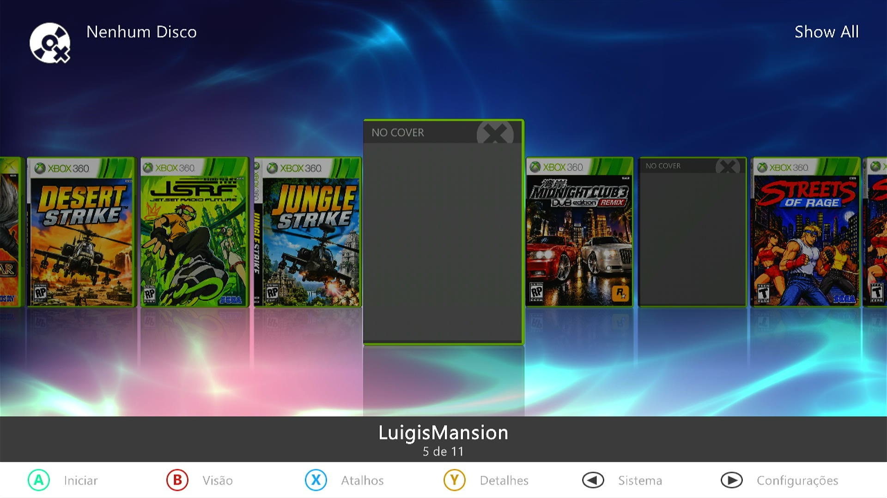
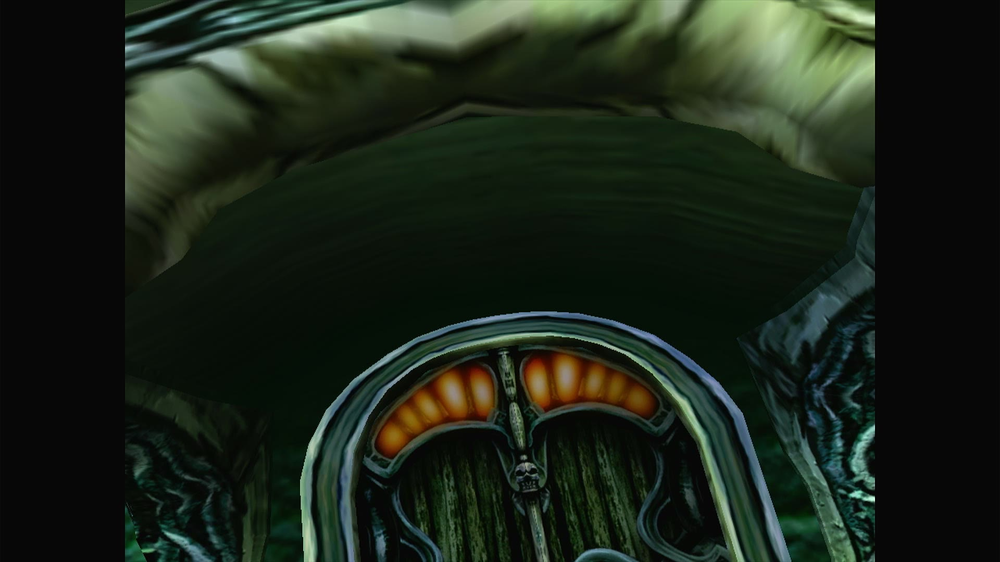
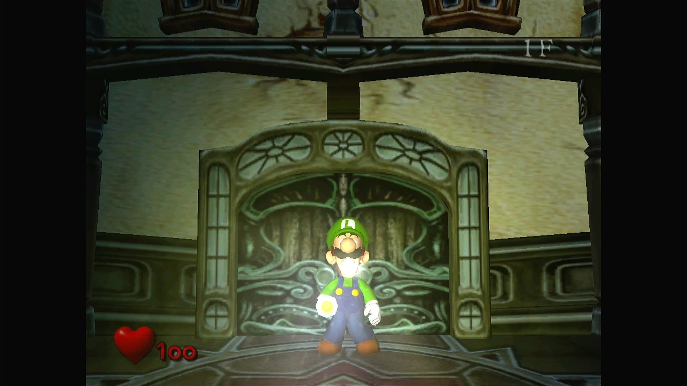
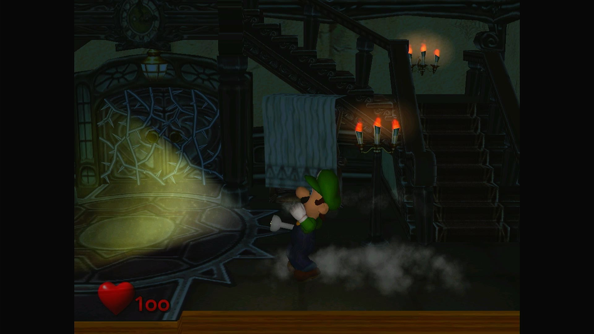

# LuigisMansion-X360

**English** | [Português (Brasil)](#português-brasil)

A native Xbox 360 port of **Luigi's Mansion** (Nintendo GameCube), **in development**.

The game is statically recompiled from the user's own disc into a native `.xex` that runs directly on the
Xbox 360, with no GameCube emulation. Base version: the European release (English, French, German, Spanish
and Italian).

**Status:** early development. It already boots on a real Xbox 360: menus, language selection, the intro and
gameplay in the mansion. Audio, saves, performance and many details are still being worked on.

**No code is published yet.** It will come later. **No game data is or will be included:** you will need your
own copy of the game.

## Screenshots (real Xbox 360 hardware)

| | |
|---|---|
|  |  |
|  |  |
|  |  |

---

## Português (Brasil)

Port nativo de **Luigi's Mansion** (Nintendo GameCube) para Xbox 360, **em desenvolvimento**.

O jogo é recompilado estaticamente a partir do disco do próprio usuário para um `.xex` nativo, que roda direto
no Xbox 360, sem emulação de GameCube. Versão-base: a europeia (inglês, francês, alemão, espanhol e italiano).

**Estado:** início do desenvolvimento. Já inicia num Xbox 360 de verdade: menus, escolha de idioma, introdução e
jogabilidade na mansão. Áudio, saves, desempenho e muitos detalhes ainda estão em andamento.

**Ainda não há código publicado.** Ele virá depois. **Nenhum dado do jogo é ou será incluído:** será preciso ter a
sua própria cópia do jogo.

Luigi's Mansion is a trademark of Nintendo. This project is not affiliated with or endorsed by Nintendo.
